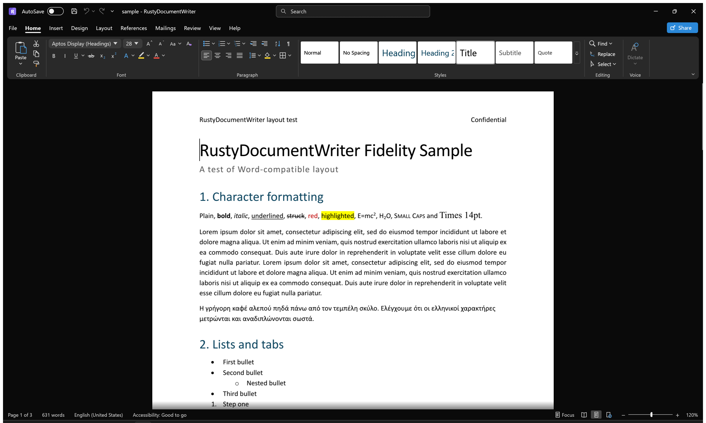

<div align="center">

# 📜 RustyDocumentWriter

### *The open-source word processor built for pixel-faithful DOCX layout.*

[](https://github.com/argyris-mpalampanisb/RustyDocumentWriter/actions/workflows/release.yml)


**Same line breaks. Same page breaks. Nothing lost on save.** ✨



[⬇️ Download](#download) · [🎯 Fidelity](#fidelity) · [✨ Features](#features) · [🛠️ Build](#build) · [🗺️ Roadmap](#roadmap)

</div>

---

## 🤔 Why RustyDocumentWriter?

Open a `.docx` in most alternatives and pages drift: a heading jumps to the next page, a table splits in the wrong place, a list renumbers. 😩 That happens because they convert the document into their own model and lay it out with **their** rules.

RustyDocumentWriter takes the opposite approach:

- 🧬 **It keeps the DOCX document tree.** Paragraphs, runs and tables are editable, and every property bag stays as the original XML.
- 📐 **It follows the format's real-world layout rules**, including the undocumented ones, found by careful measurement.
- 💾 **It round-trips losslessly.** Parts it doesn't understand (custom XML, VBA, comments, charts…) are written back **byte-for-byte**.

---

<a id="fidelity"></a>

## 🎯 Measured, not guessed

We open the test documents in a **reference word processor**, record where every paragraph lands, and compare with RustyDocumentWriter's layout. The measurements are stored in `testdata/`, and `cargo test` checks them on every machine, with no Word needed.

| 📄 Test document | Paragraphs | Pages different from reference | Mean vertical error |
|---|:---:|:---:|:---:|
| Formatting, lists, tabs, table, image | 37 | **0** ✅ | 0.65 pt |
| Same document after RustyDocumentWriter's editing API | 38 | **0** ✅ | 0.26 pt |
| Spacing rules, widows, 2 columns, landscape | 44 | **0** ✅ | 0.28 pt |
| 80 justified paragraphs in a narrow column | 80 | **identical line counts** ✅ | — |

> 💡 For scale: 1 pt is about 1/3 of a millimetre.

<details>
<summary><b>🔬 Layout rules RustyDocumentWriter reproduces (click to expand)</b></summary>
<br>

| Rule | Reference behaviour |
|---|---|
| 📏 Line height | GDI metrics: `winAscent + winDescent + max(0, hhea.lineGap − (win − hhea))` |
| ↕️ Paragraph spacing | **max**(space-after, space-before), *not* the sum |
| 📃 Top of page | space-before dropped after page breaks; at a next-page **section** break the reference keeps `before − previous after` |
| ⏎ Page breaks | in compatibility mode 15 the ¶ stays on the page-break line |
| ↔️ Justification | compatibility mode 15 **shrinks spaces by up to 25 %** to fit a line (calibrated: 0.25 matches 80/80, 0.20 and 0.30 don't) |
| 🔤 Kerning | OpenType GPOS `kern` pairs, applied only when `w:kern` is on |
| 👶 Widows & orphans | the 2-line rule, keep-with-next chains (even into tables), keep-lines |
| 🧮 Tables | grid from `w:tblGrid`, half border widths added to row height, repeating headers, no header-only page bottoms, merged rows kept together |
| 🎨 Styles | docDefaults → table style (with banding) → paragraph style → numbering → direct; toggle properties XOR |
| 🌈 Theme colours | `themeShade`/`themeTint` in RGB (accent1 × BF = `#0F4761`) |
| ⇥ Tabs | default stops from the column edge, hanging-indent stop, right/center/decimal tabs, leaders |
| 🔢 Numbering | overrides, `numStyleLink`, `isLgl`, `lvlRestart`, shared counters, Symbol/Wingdings bullets |

</details>

---

<a id="features"></a>

## ✨ Features

<table>
<tr>
<td width="50%" valign="top">

### 📄 Documents
- 📚 Sections: size, orientation, margins, columns, section breaks
- 🔝 Headers & footers with `PAGE` / `NUMPAGES`
- 📝 Footnotes
- 🖼️ Inline & floating images, with wrapping
- 🗃️ Tables: merges, shading, borders, style banding
- 🔖 Lists, bullets, multilevel numbering
- 🧾 Text boxes, borders, shading, highlights
- ✏️ Tracked changes (insertions shown, deletions hidden)
- 🀄 East Asian document grids

</td>
<td width="50%" valign="top">

### ⌨️ Editing
- ✍️ Typing, IME, selection by mouse & keyboard
- ↩️ Undo / redo, cut / copy / paste
- 🅱️ Bold, italic, underline, strike, sub/superscript
- 🎨 Font, size, colour, highlight, case
- 📐 Alignment, indents, spacing, borders, shading
- 🏷️ Style gallery
- 🔍 Find & replace
- ➕ Insert tables, pictures, symbols, breaks, dates
- 🧭 Navigation pane, ruler, zoom, dark page mode

</td>
</tr>
</table>

### 🖥️ A familiar home
The UI is a **modern dark ribbon**: **File · Home · Insert · Design · Layout · References · Mailings · Review · View · Help**, with a custom title bar, style gallery, backstage view and zoom slider. 🌙

### 🔠 Fonts that just work
RustyDocumentWriter embeds **Liberation Sans** (SIL OFL), which is **metric-compatible with Arial**: every glyph has Arial's width and line height, so Arial documents paginate identically even where Arial isn't installed. ✅ A test checks this against the real Arial.

> 🅰️ The default font of recent DOCX templates, **Aptos**, is delivered as a cloud font rather than installed on disk. Install it (a free download) for exact results on new documents; until then RustyDocumentWriter falls back to Calibri.

---

<a id="download"></a>

## ⬇️ Download

Portable, single-file builds with **no installer and no runtime**. Unzip and run! 🚀

| | 🪟 Windows 10/11 | 🍎 macOS 10.13+ | 🐧 Linux (glibc 2.35+) |
|---|:---:|:---:|:---:|
| **x64** | `rusty-document-writer-windows-x64.zip` | `rusty-document-writer-macos-x64.zip` | `rusty-document-writer-linux-x64.tar.gz` |
| **ARM64** | `rusty-document-writer-windows-arm64.zip` | `rusty-document-writer-macos-arm64.zip` | `rusty-document-writer-linux-arm64.tar.gz` |
| **Both** | | `rusty-document-writer-macos-universal.zip` | |

Grab them from the **[Releases](https://github.com/argyris-mpalampanisb/RustyDocumentWriter/releases)** page.

<details>
<summary>🍎 <b>macOS first launch</b></summary>

The app is ad-hoc signed but not notarized. Right-click **RustyDocumentWriter.app → Open** the first time, or run:

```bash
xattr -dr com.apple.quarantine RustyDocumentWriter.app
```
</details>

---

<a id="build"></a>

## 🛠️ Building from source

You need the stable [Rust toolchain](https://rustup.rs). Then:

```bash
cargo run --release                      # 🖊️  launch the editor
cargo run --release -- my-file.docx      # 📂 open a document
cargo test                               # 🧪 unit + layout-fidelity tests
```

Render pages to PNG without a window, which is handy for comparing against a reference renderer:

```bash
cargo run --release --bin rusty-document-writer-render -- my-file.docx out_dir --dpi 110
```

🤖 **CI:** `.github/workflows/release.yml` builds all six targets on GitHub's runners. Trigger it from **Actions → Release → Run workflow**, or push a `v*` tag to publish a release.

---

## 🏗️ Architecture

```
src/
├── 🧩 xml.rs        lossless XML DOM, tailored to OOXML
├── 📦 opc.rs        zip package; untouched parts saved byte-for-byte
├── 🌳 model.rs      editable paragraphs / runs / tables
├── 🎨 props.rs      the DOCX formatting cascade, themes, numbering
├── 📄 document.rs   load · save · new (modern Normal template)
├── 🔠 fonts.rs      font index, GDI metrics, GPOS kerning, bundled fonts
├── 📐 layout/       pagination · lines · tables · drawings
├── 🖌️ render.rs     own rasterizer: what you see = what was measured
├── ✏️ edit.rs       positions, typing, formatting, insertions
└── 🖥️ app/          egui UI: ribbon, canvas, backstage, icons
```

🧪 **Fidelity tooling** lives in `tools/`: PowerShell scripts that ask the reference word processor for paragraph positions, line counts and exact line breaks.

---

<a id="roadmap"></a>

## 🗺️ Roadmap

- [ ] 🌍 Complex scripts (Arabic, Hebrew, Indic) via shaping + BiDi
- [ ] 📋 Rich clipboard (paste with formatting)
- [ ] 💬 Comments & track-changes UI
- [ ] 🖨️ PDF export & printing
- [ ] ⚡ Incremental layout for huge documents
- [ ] 🧮 Table editing (rows, columns, resizing)
- [ ] 📊 Charts, SmartArt & equations rendering
- [ ] 🇬🇷 Localization, starting with Greek

---

## 🤝 Contributing

Issues and pull requests are welcome! 🎉 The best contribution of all is a **document RustyDocumentWriter lays out differently from the reference**. Run `tools/reference-positions.ps1` on it and you have a regression test. 🐛➡️✅

## 📜 License

**MIT**: see [LICENSE](LICENSE). The bundled Liberation Sans fonts (`assets/fonts/`) are under the SIL Open Font License 1.1.

📦 Every release archive also includes **`THIRD-PARTY-LICENSES.html`**, which lists the copyright notices and licenses of all the open-source crates RustyDocumentWriter is built with. It is generated by [cargo-about](https://github.com/EmbarkStudios/cargo-about) (`about.toml`):

```bash
cargo install cargo-about --locked --features cli
cargo about generate about.hbs -o THIRD-PARTY-LICENSES.html
```

## ™️ Trademarks

Aptos is a trademark of the Microsoft group of companies. Arial is a trademark of The Monotype Corporation. RustyDocumentWriter is an independent open-source project and is **not affiliated with, endorsed by or sponsored by Microsoft or Monotype**. These names are used only to describe file-format compatibility.

<div align="center">
<br>

Made with 🦀 and ❤️, one point at a time.

</div>
